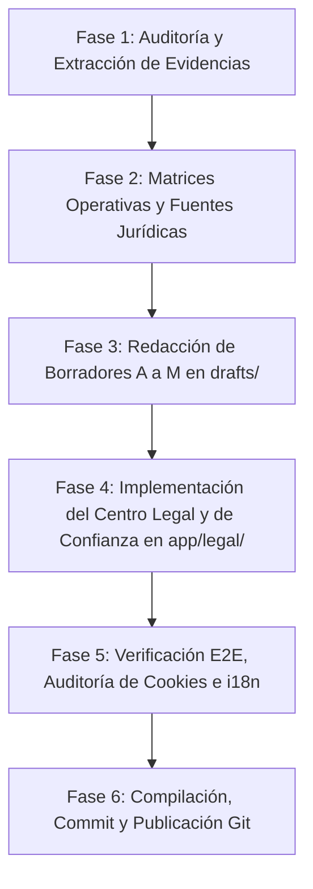

# Plan Integral: Actualización del Marco Contractual, de Privacidad, Cookies e IA
## PrintPrice Pro — Centro Legal y de Confianza (Legal & Trust Center)

**Fecha:** 24 de octubre de 2026  
**Entidad Operadora:** Print Price Pro SIA (Reg. 40203631570, Letonia)  
**Alcance:** Web corporativa (`printprice.pro`), subdominios (`budget.printprice.pro`, `preflight.printprice.pro`, `control.printprice.pro`, `mockup.printprice.pro`) y puntos de aceptación asociados.  
**Estado:** En ejecución. Todos los borradores contractuales se marcan explícitamente como *Borrador pendiente de aprobación jurídica*.

---

### 1. Objetivos y Criterios Rectores

1. **Alineación con el Modelo de Negocio Real y Decisiones Confirmadas:**
   - Supresión integral de cualquier mención a pruebas gratuitas de 14, 21 o cualquier otra duración en todo el sitio web y documentación.
   - Claridad en el flujo de facturación y cobro: **la imprenta vende y cobra directamente al cliente**; PrintPrice actúa como plataforma tecnológica intermediaria y factura posteriormente una **comisión del 4 % mensual** sobre la base neta de producción cobrada en transacciones originadas a través del marketplace.
   - Rigurosa separación entre decisiones comerciales confirmadas y propuestas en estudio (cuotas de suscripción, consumos de créditos FIX IT, cuotas de proveedores de papel o escalados permanecen como *no aprobados* y no se convierten en compromisos contractuales).
   - Ausencia total de garantías absolutas, falsas certificaciones («GDPR certified», «legally hardened», «SOC-2 compliant» no acreditado) y deslinde exacto entre servicios deterministas (cálculo e imposición, preflight) y herramientas complementarias con IA (generación de maquetas 3D con visión).

2. **Evidencia e Identidad Corporativa Real:**
   - Razón social: **Print Price Pro SIA**.
   - Código de registro: **40203631570**.
   - IVA: **LV40203631570**.
   - Domicilio social: Bruņinieku iela 60-8, Latgales priekšpilsēta, Rīga, LV-1009, Letonia.
   - Canales oficiales atendidos: `info@printprice.pro` y `privacy@printprice.pro`.

3. **Arquitectura Documental y Centro Legal:**
   - Creación del **Centro Legal y de Confianza** (`/legal`) con navegación estructurada por perfiles (Imprentas, Proveedores de Papel, Editoriales, Particulares/Autores) y documentos transversales.
   - Resumen en lenguaje claro (*Plain Language Summary*) complementario al texto articulado íntegro.
   - Soporte multilingüe completo con paridad semántica exacta en Español (ES), Inglés (EN) y Alemán (DE).
   - Vista imprimible optimizada (`@media print` y botón directo).
   - Preferencias de cookies persistentes con opciones equivalentes de Aceptar, Rechazar y Configurar.

---

### 2. Estructura de Entregables en `docs/implementation/legal-trust-center/`

| Documento | Propósito |
| :--- | :--- |
| `PLAN.md` | Hoja de ruta, fases de trabajo y directrices metodológicas (este documento). |
| `STATUS.md` | Estado de avance, tareas completadas, pendientes y métricas de ejecución. |
| `CURRENT_LEGAL_AUDIT.md` | Auditoría de contradicciones previas (14/21 días trial, flujos de cobro antiguos, claims desproporcionados). |
| `BUSINESS_MODEL_AND_CONTRACT_MATRIX.md` | Matriz detallada de los 6 flujos operativos (PRICE IT, FIX IT, Mockup, PRINT IT, Clientes propios, Aprovisionamiento de papel). |
| `LEGAL_SOURCES.md` | Fuentes oficiales vigentes (EUR-Lex, Comisión Europea, Datu valsts inspekcija, PTAC Letonia, RGPD, AI Act, DSA, P2B). |
| `DATA_PROCESSING_MAP.md` | Mapeo exhaustivo de finalidades, bases jurídicas, categorías de datos, plazos de conservación y transferencias. |
| `COOKIE_INVENTORY.md` | Inventario técnico real de cookies, LocalStorage y telemetría antes y después del consentimiento. |
| `AI_USAGE_AND_PROVIDER_MATRIX.md` | Clasificación entre motores deterministas y funciones con IA (Google Gemini en Mockup), límites y supervisión. |
| `ACCEPTANCE_AND_VERSIONING_SPEC.md` | Especificación de puntos de aceptación en corporativa, Budget y Control Plane, modelo de datos de consentimientos y versionado. |
| `DECISIONS_REQUIRED.md` | Cuestionario conciso con las decisiones comerciales pendientes (base exacta del 4 %, devengo, divisas, etc.). |
| `VALIDATION.md` | Registro de verificación técnica, comprobaciones de rutas, builds y pruebas de paridad. |
| `drafts/` | Colección completa de borradores contractuales y políticas (A a M) en ES, EN y DE. |

---

### 3. Fases de Ejecución

1. **Fase 1: Auditoría Técnica y Contractual:** Identificación y corrección de incoherencias en rutas públicas, componentes y markdown histórico.
2. **Fase 2: Formalización de Matrices Técnicas:** Elaboración de la matriz de flujos, inventario de cookies, mapa de datos RGPD y matriz de IA.
3. **Fase 3: Redacción de los 13 Textos Jurídicos:** Redacción exhaustiva de los documentos A a M adaptados a la realidad operativa de PrintPrice.
4. **Fase 4: Implementación Frontend en `app/legal/`:** Desarrollo de la interfaz del Centro Legal con diseño onboarding, responsive y accesible.
5. **Fase 5: Verificación Técnica y Validación:** Pruebas con `npm run build`, comprobación de ausencia de enlaces rotos y verificación de cookies.
6. **Fase 6: Publicación:** Commit ordenado y `git push origin feat/corporate-stakeholder-experience`.
