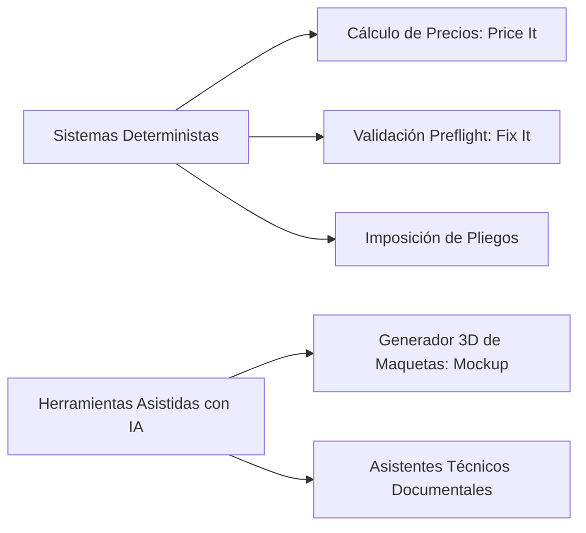

# POLÍTICA DE INTELIGENCIA ARTIFICIAL, AUTOMATIZACIÓN Y DETERMINISMO
> **ESTADO DEL DOCUMENTO:** BORRADOR PENDIENTE DE APROBACIÓN JURÍDICA  
> **DOCUMENT STATUS:** DRAFT PENDING FORMAL LEGAL APPROVAL  
> **DOKUMENTENSTATUS:** ENTWURF VORBEHALTLICH RECHTLICHER PRÜFUNG  
> **Versión:** 2026.1-draft | **Fecha de emisión:** Octubre 2026

---

### 1. Principio Fundamental: Separación entre Determinismo e Inteligencia Artificial
En PrintPrice OS diferenciamos con rigor matemático y normativo los procesos que operan de forma estrictamente determinista de aquellos que utilizan modelos asistidos de inteligencia artificial:

1. **Sistemas Deterministas (Cálculo, Preflight e Imposición):**
   - No utilizan redes neuronales generativas ni conjeturas estadísticas.
   - Siguen algoritmos matemáticos y especificaciones formales ISO (ISO 15930, PDF/X).
   - Ante los mismos datos de entrada y el mismo archivo, el resultado computacional es siempre exactamente idéntico.
2. **Herramientas Asistidas con IA (Mockup 3D):**
   - Utilizan modelos de visión por computador y renderizado generativo ambiental (Google Cloud Vertex AI en centros de datos de la UE) para proyectar perspectivas comerciales e iluminación de estudio.
   - Es una función complementaria de marketing visual.

---

### 2. Compromisos Inviolables de Privacidad y Propiedad Intelectual en IA
1. **Cero Entrenamiento con Archivos de Clientes:**
   Print Price Pro SIA garantiza que **los archivos cargados por los usuarios (manuscritos, maquetas, imágenes de cubierta o documentos PDF) no se utilizan para entrenar, reentrenar ni optimizar modelos fundacionales de inteligencia artificial** de PrintPrice ni de sus proveedores tecnológicos.
2. **Preservación Permanente del Archivo Original:**
   Los archivos originales aportados por el usuario se conservan intactos. Si una herramienta propone una optimización (por ejemplo, generación de sangrado perimetral asistido), dicha corrección se genera como una nueva variante identificada que **requiere siempre la aprobación humana explícita del usuario antes de sustituir cualquier elemento en la orden de producción**.
3. **No Aceptación Tácita de Pedidos ni Pagos:**
   La visualización de un resultado o maqueta generada por IA nunca desencadena automáticamente un pedido vinculante, un cargo en cuenta ni una modificación irreversible de la orden de taller sin la confirmación consciente del usuario.

---

### 3. Delimitación Técnica de Responsabilidad y Avisos Contextuales

#### A. Alcance de PrintPrice Preflight (Fix It)
- La verificación de preflight es un análisis forense de la estructura digital del PDF (cajas `TrimBox`, `BleedBox`, fuentes incrustadas, espacios de color y resolución de mapas de bits).
- **Límite técnico:** Un informe de preflight favorable **no equivale a una certificación universal de resultado impreso ni sustituye la revisión ortotipográfica, de maquetación o de estilo**, responsabilidad que corresponde al diseñador o autor antes de validar el encargo.

#### B. Alcance del Generador de Maquetas 3D (Mockup)
- **Límite visual:** Las maquetas 3D son previsualizaciones comerciales digitales generadas para escaparates online, preventas y marketing en redes.
- **No constituyen prueba física contractual:** Una maqueta 3D **no es una prueba de color certificada de imprenta (contract proof), ni una muestra de la textura física del papel, ni una medición micrométrica del lomo real**. Las dimensiones físicas del libro se rigen por la ficha técnica de taller acordada.

---

### 4. Supervisión Humana y Canales de Revisión
Cualquier usuario que detecte una anomalía en una previsualización o en una propuesta técnica generada por la plataforma puede solicitar la revisión humana directa a través del equipo de soporte en `info@printprice.pro`.
