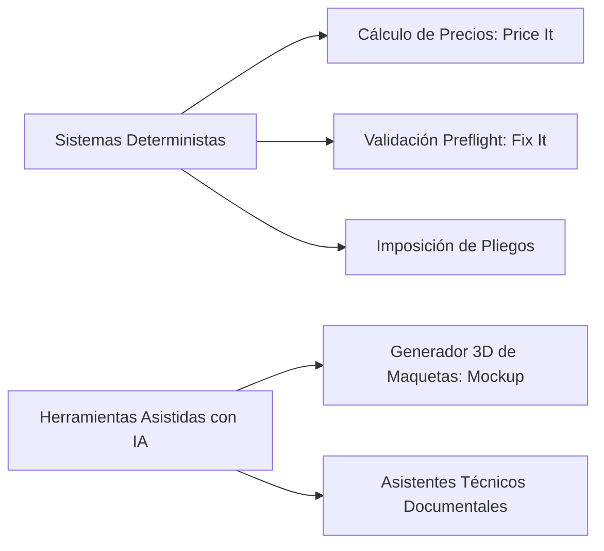

# POLÍTICA DE INTELIGENCIA ARTIFICIAL, AUTOMATIZACIÓN Y DETERMINISMO
> **ESTADO DEL DOCUMENTO:** BORRADOR PENDIENTE DE APROBACIÓN JURÍDICA  
> **DOCUMENT STATUS:** DRAFT PENDING FORMAL LEGAL APPROVAL  
> **DOKUMENTENSTATUS:** ENTWURF VORBEHALTLICH RECHTLICHER PRÜFUNG  
> **Versión:** 2026.1-draft | **Fecha de emisión:** Octubre 2026

---

### 1. Principio Fundamental: Separación entre Determinismo e Inteligencia Artificial
En PrintPrice OS diferenciamos con rigor matemático y normativo los procesos que operan de forma estrictamente determinista de aquellos que utilizan modelos asistidos de inteligencia artificial:

1. **Sistemas Basados en Reglas y Algoritmos (Cálculo, Preflight e Imposición):**
   - El motor de cotización (Price It) y el pipeline de verificación preliminar (Fix It) operan sobre reglas matemáticas, perfiles de máquina y estándares técnicos (como especificaciones ISO de artes gráficas).
   - Ante los mismos parámetros de entrada y archivos idénticos, la ejecución sigue una lógica formal predecible. No obstante, no se utiliza la afirmación categórica «100 % determinista» como garantía comercial absoluta, dado que el comportamiento en runtime puede verse condicionado por parsers de terceros, librerías gráficas o versiones de intérpretes.
2. **Componentes con Asistencia o Integración de Modelos de IA:**
   - **Mockup 3D (`mockup.printprice.pro`):** Servicio web independiente para la proyección visual y perspectiva de portadas. *Estado del proveedor:* Se atribuyó preliminarmente a Google Cloud Vertex AI, pero dicha afirmación se encuentra **NO VERIFICADA** en el repositorio corporativo al tratarse de un subdominio externo. Se retira toda garantía pública de localización o exclusión de entrenamiento hasta su acreditación contractual.
   - **Prototipo de Asistente IA (`/ai-agent`):** La plataforma contiene en desarrollo un prototipo de asistente conversacional para la resolución de dudas técnicas, interconectado mediante un proxy de prueba (`/api/v1/agents`), lo que desmiente que «Solo Mockup utiliza IA».

---

### 2. Matriz de Tratamiento por Dimensiones Técnicas (Auditoría Interna)
Para garantizar la máxima transparencia exigida por el marco de IA y privacidad, se distinguen rigurosamente cinco dimensiones técnicas:

| Dimensión | Sistemas de Reglas (Price It / Fix It) | Servicio Mockup 3D | Asistente `/ai-agent` (Prototipo) |
| :--- | :--- | :--- | :--- |
| **Almacenamiento** | Servidores Hetzner / AWS en la UE (Alemania/Finlandia). Archivos PDF temporales en volúmenes transitorios. | Almacenamiento efímero de la imagen de cubierta en el servicio de renderizado. | Sin persistencia de prompts ni historiales conversacionales en BD del control plane corporativo. |
| **Inferencia** | Algoritmos de cálculo matemático e imposición en CPUs de infraestructura europea. | Generación de visualización 3D. **NO VERIFICADO:** Proveedor, modelo y endpoint exacto de backend. | Proxy hacia endpoint mock/experimental de prueba. |
| **Logs Técnicos** | Registros de auditoría con IDs de cotización, marcas de tiempo y hashes técnicos. | Logs de acceso HTTP estándar sin retención de imágenes en logs. | Registros de depuración de peticiones HTTP en consola. |
| **Conservación** | Purga programada de archivos PDF temporales tras la generación del informe de preflight. | Las imágenes procesadas se descartan tras generar el render de salida. | Los estados de sesión se mantienen en memoria del navegador del usuario. |
| **Entrenamiento** | **No aplica:** No se utilizan modelos de aprendizaje automático. | **NO VERIFICADO:** No se dispone de contrato de servicio que certifique ausencia de entrenamiento en el proveedor externo. | **No aplica:** Prototipo sin fine-tuning ni ingesta de datos de clientes para entrenamiento. |

---

### 3. Principios de Salvaguarda y No Aceptación Tácita
1. **Preservación Permanente del Archivo Original:**
   Los archivos originales aportados por el usuario se conservan intactos. Si una herramienta propone una optimización (por ejemplo, generación de sangrado asistido), dicha corrección se genera como una nueva variante identificada que **requiere siempre la aprobación humana explícita del usuario antes de sustituir cualquier elemento en la orden de producción**.
2. **No Aceptación Tácita de Pedidos ni Pagos:**
   La visualización de un resultado o maqueta generada por cualquier herramienta nunca desencadena automáticamente un pedido vinculante, un cargo en cuenta ni una modificación irreversible de la orden de taller sin la confirmación consciente del usuario.

---

### 3. Delimitación Técnica de Responsabilidad y Avisos Contextuales

#### A. Alcance de PrintPrice Preflight (Fix It)
- La verificación de preflight es un análisis forense de la estructura digital del PDF (cajas `TrimBox`, `BleedBox`, fuentes incrustadas, espacios de color y resolución de mapas de bits).
- **Límite técnico:** Un informe de preflight favorable **no equivale a una certificación universal de resultado impreso ni sustituye la revisión ortotipográfica, de maquetación o de estilo**, responsabilidad que corresponde al diseñador o autor antes de validar el encargo.

#### B. Alcance del Generador de Maquetas 3D (Mockup)
- **Límite visual:** Las maquetas 3D son previsualizaciones comerciales digitales generadas para escaparates online, preventas y marketing en redes.
- **No constituyen prueba física contractual:** Una maqueta 3D **no es una prueba de color certificada de imprenta (contract proof), ni una muestra de la textura física del papel, ni una medición micrométrica del lomo real**. Las dimensiones físicas del libro se rigen por la ficha técnica de taller acordada.

---

### 4. Supervisión Humana y Canales de Revisión
Cualquier usuario que detecte una anomalía en una previsualización o en una propuesta técnica generada por la plataforma puede solicitar la revisión humana directa a través del equipo de soporte en `info@printprice.pro`.
