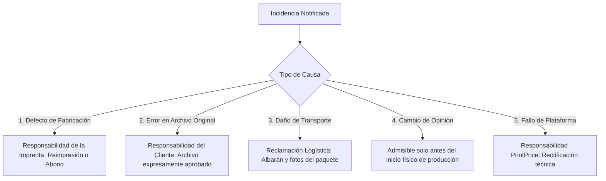

# POLÍTICA DE CANCELACIONES, DEVOLUCIONES Y RECLAMACIONES
> **ESTADO DEL DOCUMENTO:** BORRADOR PENDIENTE DE APROBACIÓN JURÍDICA  
> **DOCUMENT STATUS:** DRAFT PENDING FORMAL LEGAL APPROVAL  
> **DOKUMENTENSTATUS:** ENTWURF VORBEHALTLICH RECHTLICHER PRÜFUNG  
> **Versión:** 2026.1-draft | **Fecha de emisión:** Octubre 2026

---

### 1. Principios Generales y Diferenciación de Supuestos
Para garantizar la máxima claridad y evitar conflictos, PrintPrice Pro establece una tipología objetiva de incidencias que distingue entre las responsabilidades del comprador, de la imprenta fabricante, de la empresa transportista y de la propia plataforma:

---

### 2. Supuestos Detallados y Procedimiento Aplicable

#### Supuesto 1: Defecto Material de Fabricación (Imputable a la Imprenta)
- **Definición:** Defectos físicos ocurridos durante el proceso mecánico de producción gráfica:
  - Encuadernación deficiente (hojas que se desprenden, rotura de bisagras o lomo por cola insuficiente).
  - Impresión manchada, duplicada (*ghosting*), fuera de registro manifiesto o con rascaduras de rodillo.
  - Guillotinado defectuoso que corte textos situados dentro del margen de seguridad acordado.
  - Inversión de páginas o imposición desordenada no presente en el PDF aprobado.
- **Solución y Derechos:** La imprenta fabricante responderá legalmente de la falta de conformidad. El cliente tendrá derecho a:
  1. La **reimpresión completa o parcial sin coste** de los ejemplares defectuosos con prioridad de taller.
  2. En su defecto, la **reducción del precio o abono proporcional** de las unidades dañadas.

#### Supuesto 2: Error en el Archivo Original Aportado (Imputable al Cliente)
- **Definición:** Errores de maquetación, faltas ortográficas, imágenes en baja resolución originales, tipografías no deseadas o elementos cortados por haber sido colocados fuera de la zona segura en el PDF, habiendo sido el archivo expresamente confirmado por el cliente.
- **Solución:** Al tratarse de un bien confeccionado conforme a las especificaciones exactas del cliente y aprobado por éste, la imprenta no asume la reimpresión gratuita. El cliente podrá solicitar una nueva tirada con tarifa preferente subsanando el archivo.

#### Supuesto 3: Daño Ocurrido Durante el Transporte
- **Definición:** Cajas golpeadas, abiertas, mojadas o libros con esquinas machacadas producidas durante el trayecto de la empresa de mensajería.
- **Procedimiento:** El cliente deberá hacer constar el daño exterior en el albarán del transportista al recibir el paquete (o notificarlo dentro del plazo legal aplicable según la normativa de transporte de mercancías) y remitir fotografías del embalaje exterior y de los ejemplares a la imprenta o a `info@printprice.pro`. La imprenta tramitará el seguro de expedición y gestionará la restitución de los libros afectados.

#### Supuesto 4: Cambio de Opinión y Desistimiento
- **Antes del inicio de producción:** El cliente podrá cancelar el encargo antes de que el taller haya iniciado la preparación de planchas, corte de pliegos o tirada física, reintegrándose los importes abonados menos los costes de gestión técnica justificados.
- **Producción física iniciada:** Conforme al art. 16.c de la Directiva 2011/83/UE, los bienes personalizados carecen de derecho de desistimiento unilateral una vez comenzada la fabricación.

#### Supuesto 5: Incidencia o Fallo en la Plataforma Tecnológica
- **Definición:** Errores en la emisión de presupuestos derivados de desajustes en el software de PrintPrice o caídas de servidor que impidan la transmisión correcta del archivo.
- **Solución:** PrintPrice subsanará de inmediato la incidencia técnica, reajustará las liquidaciones de comisión pertinentes y asistirá a las partes para que la orden se ejecute según lo acordado.

---

### 3. Canal Oficial de Tramitación
Para agilizar cualquier reclamación, el usuario puede acudir al Centro de Ayuda o escribir a:
- **Correo Electrónico:** `info@printprice.pro`
- **Datos a adjuntar:** Número de pedido (`order_id`), descripción detallada de la incidencia y fotografías nítidas de los ejemplares y embalajes afectados.
