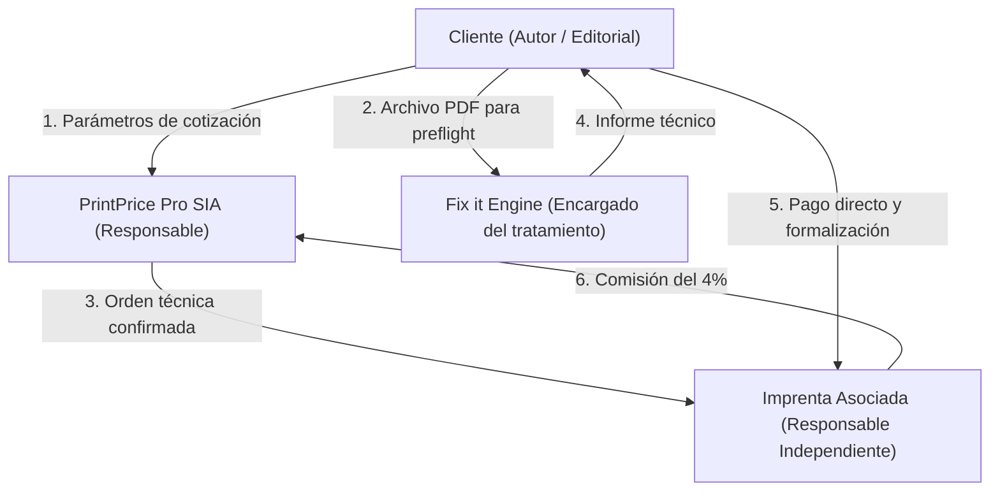

# Mapa de Flujos de Datos, Roles de Tratamiento y Subencargados (Data & Provider Map)

**Fecha de consolidación:** 25 de octubre de 2026  
**Rama:** feat/comparisons-evidence-and-legal-policy-review  
**Referencia base:** Commit 8a333d7821e5bfe976accc6b24d6dcc3fb00ab5a  
**Ámbito:** Calificación jurídica de los tratamientos de datos personales conforme al RGPD, distinción de roles de responsabilidad y catálogo verificable de subencargados e integraciones.  
**Nota de alcance lingüístico:** La documentación comparativa (`COMPARISON_COPY_ES_EN_DE.md`) está completada íntegramente en ES, EN y DE. Los 11 borradores de políticas legales están redactados en español como documentos de trabajo interno, incorporando encabezados trilingües indicativos de estado.

---

## 1. Calificación de Roles Jurídicos según el Flujo Operativo

Conforme a las directrices del Comité Europeo de Protección de Datos (Directrices 07/2020 sobre los conceptos de responsable y encargado del tratamiento en el RGPD), la calificación no depende de la denominación contractual, sino de la determinación fáctica de los fines y medios del tratamiento:

### 1.1. Flujo 1: Navegación, Cuentas de Usuario y Cotización (Price it)
- **Responsable del tratamiento:** Print Price Pro SIA.
- **Interesados:** Usuarios de la web, autores, editores, directores de compras de imprenta.
- **Datos tratados:** Nombres, correos electrónicos, identificadores de empresa, contraseñas hash, dirección IP, parámetros del libro (número de páginas, medidas, tipo de papel, tirada deseada).
- **Finalidad:** Prestación del servicio de la sociedad de la información, autenticación de cuentas y cálculo matemático de estimaciones.
- **Base jurídica:** Art. 6.1.b del RGPD (Ejecución del contrato de servicio o medidas precontractuales).

### 1.2. Flujo 2: Verificación Preflight de Archivos (Fix it)
- **Encargado del tratamiento (*Data Processor*):** Print Price Pro SIA.
- **Responsable del tratamiento (*Data Controller*):** El autor, la editorial o la imprenta que carga el archivo para su validación técnica.
- **Datos tratados:** El contenido íntegro del archivo PDF cargado (manuscritos, portadas, textos que pueden incluir nombres de autores, biografías, fotos de personas o datos biográficos en los créditos editoriales).
- **Finalidad:** Extracción determinista de metadatos de maquetación, verificación de cajas (Bleed/Trim), espacios de color, fuentes tipográficas y normalización técnica.
- **Obligación jurídica:** Exige la firma o adhesión telemática a un **Acuerdo de Encargo de Tratamiento (DPA)** conforme al Art. 28 del RGPD antes de procesar archivos que contengan datos de carácter personal.

### 1.3. Flujo 3: Tramitación del Pedido en el Marketplace (Print it)
- **Cesión legítima entre Responsables Independientes:** Print Price Pro SIA transmite a la imprenta seleccionada los datos necesarios para formalizar la producción física: especificación técnica cerrada, archivos aprobados por el cliente y datos de entrega y facturación del comprador.
- **La imprenta actúa como Responsable Independiente:** Al recibir la orden, la imprenta perfecciona un contrato mercantil directo de compraventa y fabricación de obra con el cliente final. La imprenta es responsable de la facturación legal, la custodia de los archivos en su taller y la entrega física de la mercancía.

---

## 2. Auditoría Técnica: IA Generativa vs. Sistemas Deterministas

Para cumplir con el principio de exactitud y transparencia del RGPD (Art. 5.1.a y 5.1.d) y evitar declaraciones inexactas en la política de privacidad, se delimita con rigor la tecnología empleada en cada función:

| Módulo o Servicio | ¿Utiliza Inteligencia Artificial o Modelos LLM? | Realidad Técnica Acreditada en Repositorio | ¿Los archivos se utilizan para entrenamiento? | Plazo Real de Eliminación y Ciclo de Vida |
| :--- | :--- | :--- | :--- | :--- |
| **Price it** (Cálculo de presupuestos) | **NO.** Motor 100% determinista. | Fórmulas matemáticas y matrices algebraicas de imposición en pliego resueltas exclusivamente en backend (`ppos-pricing-engine`). Cero inferencia probabilística. | No aplica (no hay modelos de aprendizaje). | En sesión hasta que el usuario guarde el proyecto en `localStorage`. |
| **Fix it** (Auditoría de PDF) | **NO.** Motor 100% determinista en el recorrido analizado. | Herramientas industriales locales de código abierto (`gs` Ghostscript, `qpdf`, `mutool`, `pdfinfo`, `exiftool`) y parsing (`pdf-lib`, `pdfjs-dist`). Cero redes neuronales, cero LLMs y cero llamadas de red externas (`ppos-preflight-engine`, `ppos-preflight-service`, `ppos-preflight-worker`). | **NO.** Ningún archivo se utiliza para entrenar algoritmos de terceros ni modelos de IA. | **[CÓDIGO OBSERVADO: RETENCIÓN TEMPORAL PROGRAMADA POR WORKER]:** • **Ubicación:** Disco local en `$PPOS_UPLOADS_DIR/tenants/{tenantId}/jobs/{jobId}/[input\|output\|temp\|reports\|previews]`. • **Mecanismo de purga:** La eliminación **no se produce tras la descarga ni al emitir el informe**. La ejecuta el worker recurrente `StorageCleanupWorker` cada 1 hora (`intervalMs = 3600000`), seleccionando trabajos con `status IN ('COMPLETED', 'FAILED')` y antigüedad `created_at < NOW() - INTERVAL 24 HOUR`, invocando `deleteJobStorage()` y borrado en BD. • **Matiz temporal:** El cómputo inicia en `created_at` (carga), no al finalizar el análisis; no constituye un plazo fijo ni un máximo garantizado de permanencia. • **Pendientes:** Auditoría del alcance y exclusiones de backups en Plesk Obsidian / IONOS y propuesta de saneamiento de trabajos bloqueados en `PROCESSING`/`QUEUED`. |
| **Mockup 3D** (Visualizador de cubierta) | **NO.** Render 100% determinista WebGL. | Computación gráfica estándar en cliente mediante WebGL / Three.js (renderizado local de geometría 3D a partir de número de páginas y calibre de papel). Sin redes neuronales ni IA generativa. | No aplica (cero modelos de IA implicados). | Puramente efímero en la memoria de la GPU/navegador del usuario; sin persistencia en servidor ni transmisión de imágenes a terceros. |
| **AI Agent Core** (/ai-agent) y **Control Plane Assistant** | **PROTOTIPO WEB / INTEGRACIÓN B2B REAL EN CONTROL PLANE.** | • En la web corporativa: Prototipo demostrativo con proxy mock en `/api/v1/agents`. • En Control Plane B2B: Integración técnica en código con la API de **Google Gemini** (`gemini-3.5-flash` vía `aiProviderAdapter.js`) para el asistente de calibración de imprentas (`calibrationAssistantService.js`). Procesa mensajes de chat y fragmentos de texto de cotizaciones B2B vía REST en `generativelanguage.googleapis.com`. | **[CONDICIONADO A CONTRATACIÓN Y CONDICIONES DEL SERVICIO]:** En Fix it no hay IA. En el asistente B2B de Control Plane, se requiere evaluar las condiciones contractuales del servicio utilizado (distinguiendo la política de no entrenamiento de la retención cero) y suscribir el DPA europeo correspondiente antes del despliegue comercial. | En la web corporativa: sin persistencia de datos reales. En Control Plane: fragmentos de cotización normalizados en MySQL (`quote_evidence_documents`), sin almacenamiento del binario PDF original. |

---

## 3. Registro de Infraestructura Técnica, Destinatarios y Transferencias

Para una estricta coherencia documental, se desglosa el inventario distinguiendo alojamiento, servicios externos y accesos de soporte:

### 3.1. Proveedor y Ubicación del Alojamiento
| Proveedor | Servicio Prestado | Sede Corporativa | Centro de Datos | Estado de Evidencia y Garantía de Transferencia |
| :--- | :--- | :--- | :--- | :--- |
| **IONOS SE** | Infraestructura de servidor dedicado / VPS, panel Plesk Obsidian y almacenamiento de aplicaciones y bases de datos. | Montabaur, Alemania (UE). | Alojamiento en Alemania (IP pública `212.227.79.67`). Ubicación concreta en centro de datos de Fráncfort am Main clasificada como **[PENDIENTE DE EVIDENCIA CONTRACTUAL U OPERATIVA]**. | **[CONFIGURACIÓN DE PRODUCCIÓN COMPROBADA]:** IP pública en Alemania asignada a IONOS SE. Contrato formal de hosting con DPA europeo y política de copias de seguridad clasificados como **[PENDIENTE DE AUDITORÍA CONTRACTUAL Y TÉCNICA]**. *Aviso:* No se deduce «cero transferencias» exclusivamente de la geolocalización de la IP o capturas de red de cliente. |

### 3.2. Servicios Externos y Destinatarios
| Servicio / Destinatario | Función Operativa | Ubicación | Estado de Evidencia |
| :--- | :--- | :--- | :--- |
| **Servicio de Correo Corporativo** | Gestión del servidor de correo SMTP/IMAP para dominios @printprice.pro. | Servidor propio en Alemania (UE). | **[VERIFICADO EN CONFIGURACIÓN DE SERVIDOR]:** Alojado en la instancia de producción. |
| **Imprentas Asociadas de la Red** | Fabricación material de libros y entrega física al cliente. | Espacio Económico Europeo. | **[MODELO CONFIRMADO]:** Destinatarios independientes que reciben los archivos técnicos únicamente tras formalizarse el pedido. |
| **Google LLC (Gemini Developer API)** | Asistencia conversacional en calibración comercial de imprentas en Control Plane (`calibrationAssistantService.js`). | Servidores de Google (EE. UU. / Global). | **[CÓDIGO OBSERVADO EN B2B DE CONTROL PLANE]:** Consume `gemini-3.5-flash` vía REST (`aiProviderAdapter.js`) conectando a `generativelanguage.googleapis.com`. No interviene en Fix It ni procesa PDFs de preflight. Requiere formalizar DPA y evaluar condiciones de retención. |
| **Cloudflare, Inc.** | Protección perimetral, analítica de red y mitigación de bots. | Red Anycast Global. | **[CÓDIGO OBSERVADO EN CSP]:** Cabeceras de seguridad en `proxy.ts` autorizan scripts y marcos de Cloudflare (`static.cloudflareinsights.com`, `challenges.cloudflare.com`). En el flujo de onboarding existe un elemento visual placeholder de Turnstile sin integración activa. **[PENDIENTE DE CORRECCIÓN EN FRONTEND]:** Retirar de `PartnerOnboardingFlow.tsx` el indicador decorativo «Cloudflare Turnstile Verified» al carecer de verificación funcional que justifique mostrarlo (sin implementar Turnstile por iniciativa propia). |
| **Stripe, Inc.** | Pasarela de cobro de suscripciones B2B de software para talleres asociados. | Irlanda (UE) / EE. UU. | **[CÓDIGO OBSERVADO EN B2B]:** Implementado en backend en modo fail-closed (desactivado si falta configuración o si `PAYMENT_EXECUTION_ENABLED=false`). |
| **Slack Technologies** | Notificaciones técnicas salientes para talleres asociados. | EE. UU. / Global. | **[CÓDIGO OBSERVADO EN ESQUEMA SQL]:** Migración 159 en Control Plane (`slack_integrations`). Inactivo por defecto. |
| **Telemetría y Analítica de Navegación** | Sistema de telemetría interno propio (*first-party*). | Dispositivo local del usuario (`localStorage`). | **[PRUEBA EJECUTADA EN NAVEGADOR]:** Sin terceros receptores. Purgado verificado tras revocación de consentimiento. |

### 3.3. Accesos de Soporte y Transferencias Internacionales
- **Acceso administrativo:** Restringido a personal técnico autorizado mediante SSH y panel Plesk Obsidian **[PENDIENTE DE AUDITORÍA FORMAL DE ACCESOS]**.
- **Copias de seguridad (Backups):** **[PENDIENTE DE AUDITORÍA OPERATIVA]** para determinar alcance, frecuencia, retención y posibles exclusiones de la ruta de almacenamiento temporal en Plesk Obsidian / IONOS.
- **Correspondencia de versiones desplegadas:** Cotejo entre los Git commit SHAs inspeccionados en local y las versiones / builds efectivamente desplegadas en el servidor clasificado como **[PENDIENTE OPERATIVO]**.
- **Transferencias internacionales:** Las llamadas al API de Gemini en Control Plane constituyen transferencias internacionales sujetas a formalización contractual con Google.

---

## 4. Medidas de Seguridad Técnicas y Organizativas (Art. 32 RGPD)

1. **Cifrado en tránsito:** Todo el tráfico HTTP externo se redirige forzosamente a HTTPS mediante certificados TLS 1.2 / TLS 1.3 con conjuntos de cifrado seguros (*Perfect Forward Secrecy*). La comunicación interna entre el proxy inverso Nginx y los servicios Fastify/Node.js se realiza mediante bucle local loopback seguro (`127.0.0.1`).
2. **Aislamiento lógico estricto por inquilino y trabajo:** Tanto en base de datos como en disco, los parámetros de cotización y los archivos de imprenta se organizan en subdirectorios segregados con identificadores de inquilino (`/storage/tenants/{tenantId}/jobs/{jobId}/`), impidiendo el acceso cruzado entre diferentes imprentas o usuarios mediante validadores de ruta (`verifyPathIsolation`).
3. **Inmutabilidad y verificación por hash:** Los archivos de impresión cargados se verifican mediante sumas de control criptográficas (SHA-256) para garantizar que el archivo recibido por la imprenta es matemáticamente idéntico al validado por el cliente.
4. **Política de retención técnica de 24 horas:** Purga programada periódica mediante el worker `StorageCleanupWorker` que borra del disco y de la base de datos todos los trabajos completados o fallidos con más de 24 horas de antigüedad.
