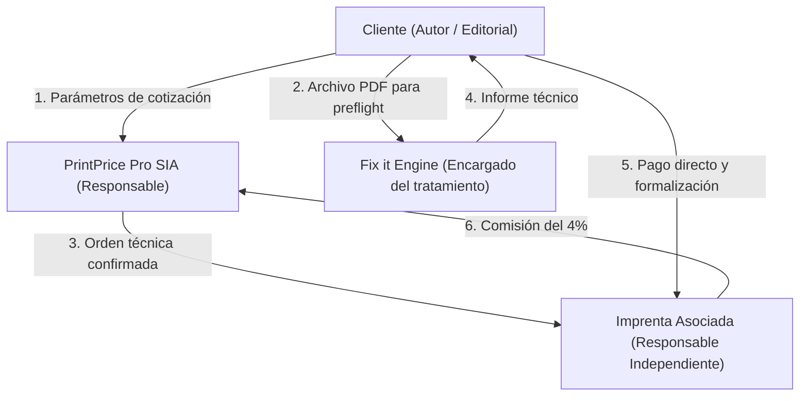

# Mapa de Flujos de Datos, Roles de Tratamiento y Subencargados (Data & Provider Map)

**Fecha de consolidación:** 25 de octubre de 2026  
**Rama:** feat/comparisons-evidence-and-legal-policy-review  
**Referencia base:** Commit 8a333d7821e5bfe976accc6b24d6dcc3fb00ab5a  
**Ámbito:** Calificación jurídica de los tratamientos de datos personales conforme al RGPD, distinción de roles de responsabilidad y catálogo verificable de subencargados e integraciones.  
**Nota de alcance lingüístico:** La documentación comparativa (`COMPARISON_COPY_ES_EN_DE.md`) está completada íntegramente en ES, EN y DE. Los 11 borradores de políticas legales están redactados en español como documentos de trabajo interno, incorporando encabezados trilingües indicativos de estado.

---

## 1. Calificación de Roles Jurídicos según el Flujo Operativo

Conforme a las directrices del Comité Europeo de Protección de Datos (Directrices 07/2020 sobre los conceptos de responsable y encargado del tratamiento en el RGPD), la calificación no depende de la denominación contractual, sino de la determinación fáctica de los fines y medios del tratamiento:

### 1.1. Flujo 1: Navegación, Cuentas de Usuario y Cotización (Price it)
- **Responsable del tratamiento:** Print Price Pro SIA.
- **Interesados:** Usuarios de la web, autores, editores, directores de compras de imprenta.
- **Datos tratados:** Nombres, correos electrónicos, identificadores de empresa, contraseñas hash, dirección IP, parámetros del libro (número de páginas, medidas, tipo de papel, tirada deseada).
- **Finalidad:** Prestación del servicio de la sociedad de la información, autenticación de cuentas y cálculo matemático de estimaciones.
- **Base jurídica:** Art. 6.1.b del RGPD (Ejecución del contrato de servicio o medidas precontractuales).

### 1.2. Flujo 2: Verificación Preflight de Archivos (Fix it)
- **Encargado del tratamiento (*Data Processor*):** Print Price Pro SIA.
- **Responsable del tratamiento (*Data Controller*):** El autor, la editorial o la imprenta que carga el archivo para su validación técnica.
- **Datos tratados:** El contenido íntegro del archivo PDF cargado (manuscritos, portadas, textos que pueden incluir nombres de autores, biografías, fotos de personas o datos biográficos en los créditos editoriales).
- **Finalidad:** Extracción determinista de metadatos de maquetación, verificación de cajas (Bleed/Trim), espacios de color, fuentes tipográficas y normalización técnica.
- **Obligación jurídica:** Exige la firma o adhesión telemática a un **Acuerdo de Encargo de Tratamiento (DPA)** conforme al Art. 28 del RGPD antes de procesar archivos que contengan datos de carácter personal.

### 1.3. Flujo 3: Tramitación del Pedido en el Marketplace (Print it)
- **Cesión legítima entre Responsables Independientes:** Print Price Pro SIA transmite a la imprenta seleccionada los datos necesarios para formalizar la producción física: especificación técnica cerrada, archivos aprobados por el cliente y datos de entrega y facturación del comprador.
- **La imprenta actúa como Responsable Independiente:** Al recibir la orden, la imprenta perfecciona un contrato mercantil directo de compraventa y fabricación de obra con el cliente final. La imprenta es responsable de la facturación legal, la custodia de los archivos en su taller y la entrega física de la mercancía.

---

## 2. Auditoría Técnica: IA Generativa vs. Sistemas Deterministas

Para cumplir con el principio de exactitud y transparencia del RGPD (Art. 5.1.a y 5.1.d) y evitar declaraciones inexactas en la política de privacidad, se delimita con rigor la tecnología empleada en cada función:

| Módulo o Servicio | ¿Utiliza Inteligencia Artificial o Modelos LLM? | Realidad Técnica Acreditada en Repositorio | ¿Los archivos se utilizan para entrenamiento? | Plazo Real de Eliminación |
| :--- | :--- | :--- | :--- | :--- |
| **Price it** (Cálculo de presupuestos) | **NO.** Motor 100% determinista. | Fórmulas matemáticas y matrices algebraicas de imposición en pliego resueltas exclusivamente en backend. Cero inferencia probabilística. | No aplica (no hay modelos de aprendizaje). | En sesión hasta que el usuario guarde el proyecto en localStorage. |
| **Fix it** (Auditoría de PDF) | **NO.** Motor 100% determinista. | Parser sintáctico de objetos PDF y cálculo de geometrías vectoriales contra normas ISO 15930 (PDF/X). Sin redes neuronales ni LLMs. | **NO.** Ningún archivo se utiliza para entrenar algoritmos de terceros ni modelos públicos. | **Realidad en código:** Eliminación automática tras procesamiento o descarga (`app/products/preflight/page.tsx`). Ventana de 24–72 h calificada como **[PROPUESTA OPERATIVA SUJETA A APROBACIÓN TÉCNICA]**. |
| **Mockup 3D** (Visualizador de cubierta) | **NO.** Render 100% determinista WebGL. | Computación gráfica estándar en cliente mediante WebGL / Three.js (renderizado local de geometría 3D a partir de número de páginas y calibre de papel). Sin redes neuronales ni IA generativa. | No aplica (cero modelos de IA implicados). | Puramente efímero en la memoria de la GPU/navegador del usuario; sin persistencia en servidor ni transmisión de imágenes a terceros. |
| **AI Agent Core** (/ai-agent) | **PROTOTIPO ASISTIDO.** | Interfaz interactiva de demostración con proxy mock en /api/v1/agents. No realiza llamadas autónomas directas a LLMs desde el cliente web corporativo. | No aplica en fase actual de maqueta técnica interactiva. | Sin persistencia de datos reales de clientes en el prototipo. |

---

## 3. Registro Oficial de Subencargados e Infraestructura Técnica

Print Price Pro SIA recurre a los siguientes prestadores de servicios que actúan como subencargados del tratamiento para la operatividad de la plataforma corporativa:

| Subencargado / Proveedor | Servicio Prestado | Sede y Jurisdicción | Centro de Datos | Garantía de Transferencia Internacional |
| :--- | :--- | :--- | :--- | :--- |
| **IONOS SE** | Infraestructura de computación en nube, servidor dedicado / VPS y almacenamiento de aplicaciones. | Montabaur, Alemania (Unión Europea). | Centros de datos certificados en Alemania / Fráncfort (UE). | **No existe transferencia fuera del EEE.** Sujeto al marco de protección de datos de la UE y DPA B2B bajo el RGPD. |
| **Proveedor de Correo Electrónico Corporativo** | Gestión del servidor de correo SMTP/IMAP para dominios @printprice.pro. | Alojado en la infraestructura propia del servidor dedicado (Plesk Obsidian, IONOS SE, Alemania). | Alemania (UE). | **No existe transferencia internacional.** |
| **Telemetría y Analítica de Navegación** | Sistema de telemetría interno propio (*first-party*). | Operado directamente por PrintPrice Pro SIA en el navegador del usuario y backend propio. | Dispositivo local del usuario / Servidores en Alemania. | **No hay terceros receptores.** Cero datos transmitidos a Google, Meta u otras redes de publicidad. |
| **Proveedor de Pasarela de Pagos (Comisiones B2B)** | Cobro de la comisión del 4% y gestión de recibos bancarios a imprentas. | Entidad financiera europea con licencia bancaria en la UE (SEPA B2B). | Unión Europea. | Transferencias electrónicas intracomunitarias reguladas por normativa bancaria de la UE (Directiva PSD2 / PSR). |

---

## 4. Medidas de Seguridad Técnicas y Organizativas (Art. 32 RGPD)

1. **Cifrado en tránsito:** Todo el tráfico HTTP se redirige forzosamente a HTTPS mediante certificados TLS 1.3 con conjuntos de cifrado seguros (*Perfect Forward Secrecy*).
2. **Aislamiento lógico de datos de clientes:** Los parámetros de cotización y los archivos de imprenta se organizan en contenedores o directorios segregados con identificadores de inquilino (*tenant separation*), impidiendo el acceso cruzado entre diferentes imprentas o usuarios.
3. **Inmutabilidad y verificación por hash:** Los archivos de impresión cargados se verifican mediante sumas de control criptográficas (SHA-256) para garantizar que el archivo recibido por la imprenta es matemáticamente idéntico al validado por el cliente.
4. **Política de retención estricta:** Purga programada periódica mediante cronjobs automáticos en servidor de archivos temporales de preflight que no se hayan asociado a un pedido en firme.
