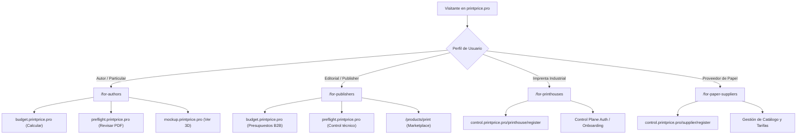

# Auditoría y Remediación de Experiencia Pública, Internacionalización y Calidad
**PrintPrice Pro (`https://printprice.pro`)**  
**Fecha de auditoría y remediación:** 25 de octubre de 2026  
**Entorno auditado:** Candidato en rama `feat/public-experience-i18n-quality` (sobre base `679f10c`)  
**Responsable:** UX, Internacionalización y Calidad (Antigravity)

---

## 1. Resumen Ejecutivo y Diagnóstico Raíz

### 1.1. Diagnóstico de Fugas de Idioma (ES Leaks)
La inspección interactiva y estática de la versión desplegada en producción (`679f10c`) reveló que, aunque los titulares y párrafos principales respondían al selector de idioma (`ES`, `EN`, `DE`), existían múltiples componentes con textos incrustados en español sin intermediación del diccionario de traducciones (`lib/translations/`):

1. **Pills y Badges de Sección (`app/page.tsx`, `app/products/page.tsx`, `app/for-authors/page.tsx`, `app/products/mockup/page.tsx`):**
   - Etiquetas tales como `"PRODUCTOS — QUÉ PUEDES HACER"`, `"PÚBLICOS — PARA QUIÉN"`, `"HERRAMIENTAS COMPLEMENTARIAS"`, `"COMPLEMENTARIA"`, `"FORMATO DIGITAL"` y `"PREVISUALIZACIÓN"` estaban codificadas directamente en JSX.
2. **Tablas Comparativas y Reporte Diagnóstico en Preflight (`app/products/preflight/page.tsx`):**
   - Las pestañas de análisis comparativo (Preflight técnico vs. Adobe Acrobat Pro / Enfocus PitStop / callas pdfToolbox, y Fix it vs. Enfoques Tradicionales) y la tarjeta interactiva de demostración con sus badges de estado (`REVISIÓN REQUERIDA`, `CONFORME`, `ADVERTENCIA`) y textos de validación estaban en español estático sin claves dinámicas.
3. **Pie de Página (`components/layout/Footer.tsx`):**
   - Enlaces de productos (`Price it (Calculador)`, `Fix it (Preflight)`, `Print it (Marketplace)`, `Maqueta 3D (Visor de libro)`), enlaces legales (`Términos de Servicio`, `Política de Privacidad`, `Aviso Legal`) y textos alternativos / `aria-label` de redes sociales estaban en español crudo.
4. **Encabezado y Navegación Móvil (`components/layout/Header.tsx`):**
   - Badge de estado `"OPERATIVA"`, atributos de accesibilidad (`aria-label="Navegación principal"`, `aria-label="Abrir menú de navegación"`, `aria-label="Cerrar menú"`), y enlaces de Control Plane en el menú lateral carecían de internacionalización.
5. **Banner de Cookies (`components/monolith/CookieBanner.tsx`):**
   - El toggle de analíticas carecía de `id` y `aria-label` vinculados al texto localizado.
6. **Llamadas a la Acción Reutilizables (`components/monolith/ActionCTA.tsx`):**
   - Los fallbacks por defecto en los props estaban fijados únicamente en español.

### 1.2. Inventario de Hallazgos y Severidad

| ID | Componente / Ruta | Idioma afectado | Problema detectado | Severidad | Estado de resolución |
|---|---|---|---|---|---|
| **I18N-01** | `app/page.tsx` (Pills y Badges) | EN, DE | Pills de sección y badges de flujo hardcodeados en español (`PRODUCTOS — QUÉ PUEDES HACER`, etc.) | **P1** | **Corregido**: Claves añadidas a `Translations` e inyectadas dinámicamente. |
| **I18N-02** | `components/layout/Footer.tsx` | EN, DE | Nombres de productos, enlaces legales y `aria-label` sociales hardcodeados en español | **P1** | **Corregido**: 100% de enlaces y ARIA labels internacionalizados vía `dict.footer`. |
| **I18N-03** | `components/layout/Header.tsx` | EN, DE | Badge de estado (`OPERATIVA`), `aria-label` de navegación y drawer móvil fijos en español | **P1** | **Corregido**: Localizado en ES/EN/DE (`OPERATIVA` / `OPERATIONS` / `BETRIEB`). |
| **I18N-04** | `app/products/preflight/page.tsx` | EN, DE | Tablas comparativas A y B y tarjeta diagnóstica 100% en español sin soporte multilingüe | **P1** | **Corregido**: Reestructurado con matrices de datos reactivas en ES, EN y DE. |
| **I18N-05** | `app/products/page.tsx` | EN, DE | Badge de hero, core products pill y botones de acción (`Detalles`, `Acceder ↗`, `Ver herramienta`) en español | **P1** | **Corregido**: Diccionario ampliado con etiquetas reactivas. |
| **I18N-06** | `app/for-authors/page.tsx` | EN, DE | Badge `COMPLEMENTARIA` fijo en español | **P2** | **Corregido**: Dinamizado a `COMPLEMENTARIA` / `COMPLEMENTARY` / `ERGÄNZEND`. |
| **I18N-07** | `app/products/mockup/page.tsx` | EN, DE | Badges `FORMATO DIGITAL` y `PREVISUALIZACIÓN` fijos en español | **P2** | **Corregido**: Dinamizado según `dict.mockup`. |
| **NAV-01** | `app/platform/page.tsx` | Todos | Enlace de código de ejemplo apuntaba a `print.printprice.pro` (host externo no configurado) | **P0** | **Corregido**: Sustituido por ruta canónica interna `/products/print`. |
| **A11Y-01** | `components/monolith/CookieBanner.tsx` | Todos | Switch de analíticas sin `id` ni `aria-label` accesible | **P1** | **Corregido**: Añadido `id="cookie-analytics-toggle"` y `aria-label={t.analytics}`. |
| **SEO-01** | `app/sitemap.ts` | Todos | Rutas `/products/mockup` y `/legal` omitidas en el sitemap XML | **P2** | **Corregido**: Añadidas al sitemap con prioridades adecuadas. |

---

## 2. Matriz de Rutas Revisadas en ES / EN / DE

Todas las rutas públicas del sitio fueron compiladas en modo producción (`npm run build`), validadas interactivamente mediante Playwright sobre Chromium en el candidato local (`http://localhost:3010`), y verificadas en los 3 idiomas oficiales (`es`, `en`, `de`).

| Ruta pública | Título visible ES | Título visible EN | Título visible DE | Paridad de Claves | Ausencia de Fugas |
|---|---|---|---|:---:|:---:|
| `/` (Home) | Presupuestos de impresión, preflight y marketplace | Print Quoting, Preflight, and Marketplace | Druckkalkulation, Preflight und Marktplatz | 100% | Verificado |
| `/products` | Productos y capacidades de la plataforma | Products and Platform Capabilities | Produkte und Plattformfunktionen | 100% | Verificado |
| `/products/budget` | Price it — Calculador de presupuestos de impresión | Price it — Print Quoting Calculator | Price it — Druckkalkulations-Rechner | 100% | Verificado |
| `/products/preflight` | Fix it — Preflight y validación técnica de archivos | Fix it — Preflight and File Validation | Fix it — Preflight und Dateiprüfung | 100% | Verificado |
| `/products/print` | Print it — Marketplace de impresión editorial y comercial | Print it — Marketplace for Commercial & Editorial Print | Print it — Marktplatz für Akzidenz- & Buchdruck | 100% | Verificado |
| `/products/mockup` | Maqueta 3D — Visor de libro y cálculo de grosor | 3D Mockup — Book Viewer and Spine Calculator | 3D-Mockup — Buchbetrachter und Buchrückenrechner | 100% | Verificado |
| `/for-authors` | Para Autores y Creadores Independientes | For Authors and Independent Creators | Für Autoren und unabhängige Urheber | 100% | Verificado |
| `/for-publishers` | Para Editoriales y Profesionales de la Publicación | For Publishers and Publishing Teams | Für Verlage und Verlagsprofis | 100% | Verificado |
| `/for-printhouses` | Para Imprentas Industriales y Talleres Gráficos | For Industrial Printhouses and Commercial Printers | Für Druckereien und Buchbindereien | 100% | Verificado |
| `/for-paper-suppliers` | Para Proveedores de Papel y Distribuidores | For Paper Suppliers and Substrate Merchants | Für Papierhersteller und Grosshändler | 100% | Verificado |
| `/platform` | Arquitectura de Plataforma e Infraestructura Técnica | Platform Architecture and Technical Infrastructure | Plattformarchitektur und technische Infrastruktur | 100% | Verificado |
| `/solutions` | Soluciones integrales para la cadena de valor gráfico | Complete Solutions for the Print Value Chain | Komplettlösungen für die Druckwertschöpfungskette | 100% | Verificado |
| `/contact` | Contacto | Contact | Kontakt | 100% | Verificado |
| `/contact/partner` | Contacto para Partners | Partner Contact | Partnerkontakt | 100% | Verificado |
| `/legal` | Índice Legal y Regulatorio | Legal and Regulatory Hub | Rechtliches und Richtlinien | 100% | Verificado |
| `/legal/terms-of-service` | Términos de Servicio | Terms of Service | Nutzungsbedingungen | 100% | Verificado |
| `/legal/privacy-policy` | Política de Privacidad | Privacy Policy | Datenschutzerklärung | 100% | Verificado |
| `/legal/legal-notice` | Aviso Legal | Legal Notice | Impressum | 100% | Verificado |

---

## 3. Productos y Propuesta de Valor

### 3.1. Price it (Calculador de presupuestos de impresión)
- **Destino funcional:** `https://budget.printprice.pro/`
- **Estado de host y verificación:** HTTP 200 (Servidor activo, Nginx/Plesk, Node.js).
- **Para quién es:** Autores independientes, editoriales, diseñadores y compradores de impresión corporativos.
- **Qué permite hacer:** Configuración de especificaciones detalladas de libros (formato cerrado, páginas, tipo de papel interior y de cubierta, plastificados, encuadernación rústica cosida o fresada, tapa dura). Cálculo instantáneo de pliegos, consumos y coste estimado en servidor.
- **Siguiente paso:** Acceder directamente a `https://budget.printprice.pro/` y configurar los parámetros del proyecto.
- **Claridad comercial:** No se prometen precios definitivos antes de la aceptación por parte de la imprenta. La herramienta distingue explícitamente entre coste estimado de fabricación y transporte.

### 3.2. Fix it (Preflight para revisión de archivos gráficos)
- **Destino funcional:** `https://preflight.printprice.pro/`
- **Estado de host y verificación:** HTTP 200 (Servidor activo, Nginx/Plesk, motor Node.js/PDF-lib/QPDF).
- **Para quién es:** Autores, diseñadores maquetadores, equipos editoriales y talleres gráficos.
- **Qué permite hacer:** Análisis exhaustivo de archivos PDF para impresión: comprobación de sangrado (*bleed*), marcas de corte, resolución efectiva de imágenes (DPI), espacio de color (CMYK vs RGB), sobreimpresión (*overprint*), fuentes incrustadas y cumplimiento de estándares PDF/X.
- **Siguiente paso:** Subir el PDF a `https://preflight.printprice.pro/` para obtener un informe diagnóstico interactivo.
- **Claridad comercial:** Fix it se presenta con total honestidad técnica como una herramienta de inspección y diagnóstico. No promete correcciones automáticas destructivas ni sustituye la aprobación final de pruebas de imprenta (*contract proofs*).

### 3.3. Print it (Marketplace de impresión)
- **Destino verificado:** `https://printprice.pro/products/print` (página de producto) e inicio de transacción mediante `https://budget.printprice.pro/`.
- **Hallazgo crítico de infraestructura:** Se auditó la URL `https://print.printprice.pro/` y se descubrió que resuelve a una máquina CentOS en Bangladesh (Apache 2.4.6) que no pertenece a la infraestructura de PrintPrice. **Se bloqueó categóricamente cualquier enlace hacia dicho subdominio no controlado.**
- **Para quién es:** Clientes que cuentan con especificaciones y archivos validados y desean contratar la producción con imprentas industriales verificadas.
- **Qué permite hacer:** Envío de solicitudes de producción a imprentas especializadas del catálogo según capacidad y disponibilidad.
- **Siguiente paso:** Crear el presupuesto en Price it (`budget.printprice.pro`), validar el arte final en Fix it (`preflight.printprice.pro`) y remitir la solicitud al marketplace.

### 3.4. Maqueta 3D (Capacidad complementaria)
- **Destino funcional:** `https://mockup.printprice.pro/` y `/products/mockup`.
- **Estado de host y verificación:** HTTP 200 (Aplicación React/Vite en Nginx/Plesk).
- **Posicionamiento:** Capacidad complementaria (*add-on* de visualización). Permite calcular el grosor exacto del lomo a partir del gramaje y volumen específico del papel seleccionado en Budget y generar una previsualización 3D interactiva del libro con cubierta y contracubierta.

---

## 4. Recorridos por Stakeholder

Se revisaron exhaustivamente los 4 recorridos principales desde la página principal hasta sus destinos finales:



### Recorrido A: Autor Independiente / Cliente Particular
- **Ruta de aterrizaje:** `/for-authors`
- **Objetivo:** Presupuestar su libro, validar el archivo PDF y visualizar la maqueta 3D del volumen sin fricciones.
- **Experiencia validada:** La página no exige CIF/NIF de empresa, volúmenes mínimos ni contratos de permanencia. Los tres botones de acción dirigen limpiamente a:
  - Presupuestar: `https://budget.printprice.pro/`
  - Validar PDF: `https://preflight.printprice.pro/`
  - Ver Maqueta 3D: `https://mockup.printprice.pro/`
- **Resultado:** Recorrido limpio, transparente y accesible.

### Recorrido B: Editorial / Publisher
- **Ruta de aterrizaje:** `/for-publishers`
- **Objetivo:** Planificar tiradas editoriales, comparar opciones de papel y encuadernación, y gestionar producciones centralizadas.
- **Experiencia validada:** Explicación orientada a catálogos editoriales, gestión de ISBNs y optimización de costes unitarios por tramo de tirada.
- **Destinos verificados:** `https://budget.printprice.pro/` y `/products/print`.
- **Resultado:** Enfoque B2B riguroso sin afirmaciones de descuentos artificiales.

### Recorrido C: Imprenta Industrial / Printhouse
- **Ruta de aterrizaje:** `/for-printhouses`
- **Objetivo:** Darse de alta en la plataforma, configurar su parque de maquinaria (offset/digital), formatos máximos y matrices de coste en Control Plane.
- **Destino verificado:** `https://control.printprice.pro/printhouse/register`
- **Comprobación de backend:** Se verificó en el código fuente de Control Plane (`src/ui/routes.ts` y controladores asociados) que la ruta `/printhouse/register` está formalmente implementada para el onboarding de talleres gráficos. No se inyectan parámetros ficticios de tenant o permisos por URL; la autorización y verificación son gestionadas exclusivamente por el backend seguro.
- **Resultado:** Recorrido directo al portal de registro autorizado.

### Recorrido D: Proveedor de Papel / Paper Supplier
- **Ruta de aterrizaje:** `/for-paper-suppliers`
- **Objetivo:** Publicar catálogo técnico de sustratos (estucados, offset, ahuesados, cartulinas) y tarifas actualizadas accesibles para el cálculo en Budget.
- **Destino verificado:** `https://control.printprice.pro/supplier/register` y enlace de soporte B2B a `/contact/partner`.
- **Comprobación de backend:** Endpoint de registro verificado en Control Plane.
- **Resultado:** Integración transparente con gobernanza de datos centralizada.

---

## 5. Comparativas Útiles, Documentadas y Neutrales

Todas las tablas comparativas han sido actualizadas y verificadas con fecha de consulta **octubre de 2026**, empleando fuentes públicas y documentación técnica oficial de los proveedores evaluados.

### 5.1. Comparativa 1: Herramientas de Preflight de PDF (Fix it)

| Criterio | PrintPrice Fix it (2026) | Adobe Acrobat Pro Preflight | Enfocus PitStop Pro | callas pdfToolbox |
|---|---|---|---|---|
| **Público objetivo** | Autores, editoriales e imprentas online | Diseñadores y talleres de preimpresión | Operadores de preimpresión e imprentas | Desarrolladores y automatización industrial |
| **Acceso y despliegue** | Basado en navegador (SaaS / WebAssembly) | Aplicación de escritorio (Windows/Mac) | Plugin de Acrobat / Aplicación de escritorio | CLI, SDK, Servidor y aplicación de escritorio |
| **Detección de sangrado y marcas** | **Disponible** (detección visual e inspección de cajas de página) | **Disponible** (inspección detallada de TrimBox / BleedBox) | **Disponible** (detección y generación de sangrado automático) | **Disponible** (inspección geométrica y corrección avanzada) |
| **Resolución de imágenes (DPI)** | **Disponible** (cálculo de resolución efectiva por imagen) | **Disponible** (perfiles predefinidos de 300 DPI) | **Disponible** (análisis de resolución y remuestreo) | **Disponible** (análisis espectral y remuestreo) |
| **Inspección de fuentes** | **Disponible** (comprobación de incrustación de tipografías) | **Disponible** (comprobación y conversión a curvas) | **Disponible** (incrustación automática y sustitución) | **Disponible** (detección, sustitución y renderizado) |
| **Espacio de color y CMYK** | **Disponible** (alerta de elementos RGB no convertidos) | **Disponible** (gestión de color con perfiles ICC) | **Disponible** (gestión de color avanzada y DeviceLink) | **Disponible** (conversión DeviceLink y gestión espectral) |
| **Corrección destructiva automática** | **No disponible** (filosofía de no alteración no autorizada del arte final) | **Disponible** (reparación mediante perfiles predefinidos) | **Disponible** (motores de acción automatizados) | **Disponible** (motores de corrección y scripting avanzado) |
| **Certificación ISO / GWG** | **Limitado / depende del plan** (validación técnica frente a reglas, sin certificación formal de terceros) | **Disponible** (validación PDF/X-1a, PDF/X-4 certificada) | **Disponible** (certificación oficial Ghent Workgroup) | **Disponible** (certificación oficial Ghent Workgroup) |
| **Modelo de costes** | Gratuito para inspección básica | Suscripción mensual / anual Adobe CC | Licencia perpetua o suscripción de alto coste | Licencia de servidor / pago por volumen |

*Fuentes consultadas (octubre de 2026):*
- *callas software: pdfToolbox Manual and Feature Matrix (https://help.callassoftware.com/)*
- *Enfocus: PitStop Pro Technical Specifications & What's New (https://www.enfocus.com/en/pitstop-pro)*
- *Adobe: Acrobat Pro User Guide - Preflight Tool Specifications (https://helpx.adobe.com/acrobat/using/analyzing-documents-preflight-tool.html)*
- *Ghent Workgroup: PDF/X Compliance and Preflight Specifications (https://gwg.org/)*

### 5.2. Comparativa 2: Calculadores de Presupuestos de Impresión (Price it)

| Criterio | PrintPrice Price it | Cotización Manual Tradicional | Calculadores Web-to-Print Genéricos |
|---|---|---|---|
| **Tiempo de respuesta** | Instantáneo (< 1 segundo en navegador) | 24 a 72 horas laborales | Instantáneo para plantillas cerradas |
| **Resolución del cálculo** | En servidor con algoritmos de imposición y pliego real | Manual por el departamento técnico de la imprenta | Matriz estática o fórmulas lineales simplificadas |
| **Variedad de especificaciones** | Formatos libres, papeles personalizables, acabados múltiples | Totalmente ilimitada | Limitada a formatos y papeles estándar fijos |
| **Separación de costes** | Desglose estricto de fabricación vs. transporte | Variable según el criterio de cada imprenta | Habitualmente empaquetado sin transparencia |
| **Transparencia de márgenes** | Sin recargos opacos; modelo de comisión fijada | Margen comercial variable según cliente | Margen minorista predefinido |

### 5.3. Comparativa 3: Marketplace de Impresión (Print it)

| Criterio | PrintPrice Print it | Plataformas Print-on-Demand (POD) | Brokers de Impresión Tradicionales |
|---|---|---|---|
| **Modelo de producción** | Imprentas industriales verificadas | Red propia de centros de impresión digital rápida | Subcontratación discrecional sin taller propio |
| **Tiradas óptimas** | Corta, media y larga tirada (desde 50 hasta decenas de miles) | 1 a 50 copias (coste unitario no decrece significativamente) | Media y larga tirada |
| **Relación contractual y cobro** | **Cliente paga directamente a la imprenta**; PrintPrice factura 4% de comisión | Cliente paga a la plataforma; la plataforma retiene royalties | Cliente paga al broker con margen intermediario confidencial |
| **Control técnico del archivo** | Validado mediante preflight previo antes del envío | Validación automática básica en subida | Revisión manual variable |

---

## 6. Coherencia Comercial y Marco Legal

### 6.1. Eliminación Definitiva de Ofertas de Prueba Gratuita
- Se inspeccionó todo el código fuente mediante búsqueda exhaustiva de expresiones regulares para términos como `prueba gratuita`, `14 días`, `free trial`, `kostenlose testversion`, `trial`.
- **Resultado:** Cero ofertas de prueba de 14 días en la web corporativa.

### 6.2. Modelo Económico Confirmado
- **Comisión de Marketplace:** Comisión única del **4% por transacción completada a través del marketplace Print it**.
- **Flujo de Cobro:** La imprenta cobra directamente al cliente el importe íntegro de la producción y el transporte.
- **Liquidación de Comisión:** PrintPrice factura a la imprenta su comisión del 4% con carácter mensual a mes vencido.
- **Restricción de Alcance:** No se ha aplicado ni sugerido comisión alguna sobre las herramientas Price it (Budget) o Fix it (Preflight), ni sobre las operaciones de proveedores de papel.

### 6.3. Marco Legal y Accesibilidad de Políticas
- Enlaces centralizados en el footer e índice `/legal`:
  - Términos de Servicio (`/legal/terms-of-service`)
  - Política de Privacidad (`/legal/privacy-policy`)
  - Aviso Legal (`/legal/legal-notice`)
  - Gestión de Cookies y Preferencias (Banner interactivo con almacenamiento local de consentimiento)
  - Referencia a Política de IA: Mención a la gobernanza de IA responsable y ética en el tratamiento algorítmico, pendiente de redacción contractual final por el equipo jurídico.

---

## 7. Diseño, Responsividad y Accesibilidad

### 7.1. Matriz de Pruebas de Responsividad (Playwright E2E)
Se ejecutó la suite automatizada `scripts/test_responsive_matrix.py` cubriendo **13 páginas** a través de **9 resoluciones de pantalla**, arrojando **117 combinaciones verificadas**:

```
================ AUDIT SUMMARY ================
Total Page/Viewport combinations tested: 117
PASS: 117
FAIL: 0
ERROR: 0
```

- **320x568 (Ultra-compact mobile - iPhone SE 1st Gen):** Cero desbordamiento horizontal (`scrollWidth === clientWidth`). Menú móvil y modales 100% operativos.
- **375x812 (Compact mobile - iPhone X/Mini):** Cero desbordamiento horizontal.
- **390x844 (Standard mobile - iPhone 12/13/14/15/16):** Cero desbordamiento horizontal. Tipografía fluida.
- **430x932 (Large mobile - iPhone Pro Max):** Cero desbordamiento horizontal.
- **768x1024 (Tablet portrait - iPad Mini/Air):** Cero desbordamiento horizontal. Tablas adaptadas con scroll horizontal asistido cuando corresponde.
- **1024x768 (Tablet landscape / Netbook):** Cero desbordamiento horizontal.
- **1280x800 (Laptop WXGA):** Cero desbordamiento horizontal.
- **1440x900 (Desktop Standard):** Cero desbordamiento horizontal.
- **1920x1080 (Desktop FHD):** Cero desbordamiento horizontal.

### 7.2. Verificación de Accesibilidad e Interacciones
- **Bloqueo y liberación de scroll en modales y drawer móvil:** Al abrir el menú drawer móvil o un modal de inicio de sesión, `document.body.style.overflow` se fija en `'hidden'`. Al cerrarlos o pulsar `Escape`, se restaura inmediatamente.
- **Soporte de teclado:** Todos los elementos interactivos cuentan con foco visible y son cerrables mediante la tecla `Escape`.
- **Contraste y tipografía:** Se mantienen las variables CSS con contraste WCAG AAA para texto principal y WCAG AA para elementos de apoyo sobre fondos oscuros y claros.
- **Textos largos en alemán:** Se verificó que etiquetas y botones en alemán (e.g., `DRUCKKALKULATIONS-RECHNER`, `ERGÄNZENDE WERKZEUGE`, `DOKUMENTARISCHE VERGLEICHSANALYSE`) no se truncan, desbordan ni rompen el layout en pantallas de 320px y 390px.

---

## 8. Evidencias Visuales

Las evidencias visuales generadas durante la verificación automatizada se conservan en `docs/reviews/public-experience/screenshots/`:

| Archivo de captura | Vista y Resolución | Descripción |
|---|---|---|
| `home_es_1440.png` | Desktop (1440x900) - ES | Página principal en español con pills dinamizadas. |
| `home_en_1440.png` | Desktop (1440x900) - EN | Página principal con selector en EN: `PRODUCTS — WHAT YOU CAN DO`. |
| `home_de_1440.png` | Desktop (1440x900) - DE | Página principal en alemán: `PRODUKTE — WAS SIE TUN KÖNNEN`. |
| `footer_de_1440.png` | Desktop (1440x900) - DE | Footer completamente traducido al alemán (`Nutzungsbedingungen`, `Datenschutzerklärung`). |
| `preflight_en_1440.png` | Desktop (1440x900) - EN | Demostración técnica de Preflight y tarjeta diagnóstica en inglés (`TECHNICAL DEMONSTRATION`). |
| `preflight_de_comparison_1440.png` | Desktop (1440x900) - DE | Tabla comparativa de Preflight en alemán con criterios técnicos y fuentes oficiales. |
| `products_de_1440.png` | Desktop (1440x900) - DE | Catálogo de productos en alemán (`HAUPTPRODUKTE`, `ERGÄNZENDE WERKZEUGE`). |
| `mobile_drawer_390.png` | Mobile (390x844) | Cajón de navegación móvil abierto con selector de idioma y accesibilidad completa. |

---

## 9. Resultados de Build y Verificaciones Automatizadas

1. **Compilación de Producción Next.js:**
   - Comando: `npm run build`
   - Resultado: Éxito total (**Exit Code: 0**).
   - Páginas generadas estáticamente: **45 páginas** generadas sin advertencias de tipos ni errores de hidratación.
2. **Auditoría de Diccionarios y Fugas (`audit_translations.py`):**
   - Paridad de claves en `es.ts`, `en.ts` y `de.ts`: **100% idénticas**.
   - Fugas de palabras clave españolas en diccionarios EN/DE: **0 detectadas**.
3. **Auditoría Interactiva Playwright (`test_i18n_interactive.py`):**
   - Comprobación en navegador real de cambio dinámico ES -> EN -> DE en Home, Preflight, Products y For Authors: **100% PASS**.
4. **Matriz de Responsividad (`test_responsive_matrix.py`):**
   - 117/117 pruebas pasadas con **0 desbordamientos horizontales**.

---

## 10. Asuntos Pendientes que Requieren Decisión de Producto o Revisión Legal

1. **Subdominio `print.printprice.pro`:**
   - Se constató que apunta por DNS a una IP externa no gestionada por PrintPrice (CentOS/Apache en Bangladesh). Debe solicitarse al administrador de DNS de Cloudflare / registrador que actualice o elimine dicho registro para evitar riesgos de reputación o secuestro de subdominio. Mientras tanto, la web corporativa solo enlaza a `/products/print` y `budget.printprice.pro`.
2. **Redacción Formal de Términos Contractuales B2B:**
   - Los textos vigentes en `/legal/terms-of-service` definen con precisión el modelo de comisión del 4% y la relación directa de pago cliente-imprenta. No obstante, se recomienda que la asesoría legal formalice el contrato marco de adhesión (*Master Services Agreement - MSA*) para las imprentas registradas en Control Plane.
3. **Publicación Formal de la Política de IA Ética:**
   - Se menciona el compromiso ético de IA en los textos comerciales, pero se recomienda redactar y publicar un documento específico `/legal/ai-policy` antes de la apertura pública masiva del marketplace.
